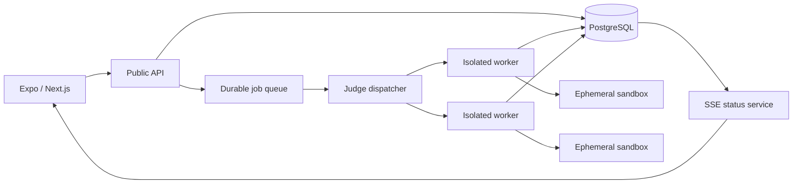

Start with the backend contract and PostgreSQL model. Do not begin by rewriting the user or admin UI.

Both new clients and the independent judge will depend on stable concepts—users, questions, submissions, permissions, and submission state. If you rewrite the clients first, they will encode today’s insecure and inconsistent APIs, and you will rewrite them again after extracting the judge.

## Recommended order

```text
0. Stabilize and secure current system
               ↓
1. Define API contract and domain model
               ↓
2. Move persistence to PostgreSQL
               ↓
3. Extract and deploy the judge infrastructure
               ↓
4. Build the Next.js admin against the new SDK
               ↓
5. Migrate the user app to Expo incrementally
               ↓
6. Retire the old backend paths and uni-app
```

A monorepo shell can be created early, but frontend feature migration should wait until the contract is stable.

## Phase 0: Stabilize before refactoring

Spend the first short iteration protecting the existing behavior.

Priorities:

- Stop returning `hiddenTests` and `referenceSolutions` from public question endpoints.
- Require authentication for submissions and derive `username` from the token.
- Replace the default JWT secret and default administrator password.
- Add request limits and judge rate limits.
- Add characterization tests around:
  - Authentication and roles.
  - Question catalog/detail responses.
  - Run versus Submit.
  - Community moderation.
  - Existing SQLite data.
- Record representative Python and Java submissions and their expected results.

This gives you a regression harness for the migration. Otherwise, failures in wrappers and test-case serialization will be hard to detect.

## Phase 1: Define the contract first

Design `/api/v1` before changing frameworks.

Use OpenAPI as the source of truth and generate a TypeScript client used by both Expo and Next.js. OpenAPI is specifically intended to act as a language-independent interface description and supports client generation. [OpenAPI specification](https://spec.openapis.org/oas/)

A minimal contract should include:

```text
POST   /v1/auth/login
POST   /v1/auth/refresh
POST   /v1/auth/logout
GET    /v1/me

GET    /v1/questions
GET    /v1/questions/:id
POST   /v1/submissions
GET    /v1/submissions/:id
GET    /v1/submissions/:id/events

GET    /v1/community/posts
POST   /v1/community/posts

GET    /v1/admin/questions
POST   /v1/admin/questions
PATCH  /v1/admin/questions/:id
POST   /v1/admin/questions/:id/publish

GET    /v1/admin/submissions
GET    /v1/admin/judge/workers
```

The important change is that submission becomes an asynchronous resource:

```json
POST /v1/submissions
{
  "questionId": "uuid",
  "questionVersion": 3,
  "language": "python",
  "sourceCode": "..."
}
```

Immediate response:

```json
{
  "id": "submission-uuid",
  "status": "queued",
  "createdAt": "..."
}
```

The client no longer waits on an HTTP request while Docker executes every test.

### REST, WebSocket, or SSE?

Use:

- REST for commands and normal resource reads.
- Server-Sent Events for submission status updates.
- REST polling as a fallback.
- WebSocket only when you later need bidirectional behavior such as collaborative editing, interactive terminals, or streaming stdin.

Judge progress is primarily server-to-client:

```text
queued → assigned → compiling → running → accepted/failed
```

SSE is simpler to authenticate, operate, reconnect, and proxy than WebSockets for this one-way stream.

## Phase 2: Introduce PostgreSQL

Move persistence before extracting the judge because the API and workers need a shared, durable submission state.

A suitable initial model is:

```text
users
roles
user_roles
sessions / refresh_tokens

questions
question_versions
test_cases
language_templates

submissions
submission_test_runs
submission_events

community_posts
community_post_tags
moderation_events

learning_progress
wrong_answer_items

outbox_events
```

Important design choices:

- Use UUIDs rather than usernames or timestamp strings as identities.
- Make question versions immutable after publication.
- Bind every submission to a specific question version.
- Keep hidden tests inaccessible through public queries.
- Store submission status transitions as events for auditability.
- Add foreign keys and explicit deletion behavior.
- Store source code and summarized execution results in PostgreSQL initially.
- Put very large logs/artifacts in object storage later and retain only their references.
- Use database migrations; never initialize production schema opportunistically at application startup.
- Do not silently fall back to an in-memory database.

### Migration strategy

For a small existing deployment:

1. Create the PostgreSQL schema.
2. Write a one-time importer for SQLite and the three JSON stores.
3. Run it in staging.
4. Compare record counts and representative records.
5. Put the old system briefly into maintenance/read-only mode.
6. Perform the final import.
7. switch the API to PostgreSQL.
8. Keep the old files as read-only rollback material for a defined period.

If the existing system is already receiving significant production traffic, use dual writing plus an outbox and reconciliation job instead.

## Phase 3: Extract the judge as infrastructure

The target should have a control plane and a worker data plane:



### Public API responsibilities

- Authenticate and authorize the caller.
- Validate question, language, and source-size limits.
- Create the submission transactionally.
- Publish a durable job.
- Return the submission ID.
- Serve submission status and results.

### Judge worker responsibilities

- Claim one job using an idempotency key.
- Load the immutable question version and hidden tests.
- Transition the submission state.
- Compile and execute in an ephemeral sandbox.
- Enforce time, memory, process, disk, network, and output limits.
- Save per-test results.
- Acknowledge or retry the job.
- Emit heartbeats so abandoned work can be recovered.

### Queue choice

Use a real durable queue:

- Managed cloud: SQS, Pub/Sub, Azure Service Bus.
- Self-hosted TypeScript stack: Redis plus BullMQ.
- More complex multi-service event platform: RabbitMQ, NATS JetStream, or Kafka.

Do not use PostgreSQL `LISTEN/NOTIFY` as the durable job queue. PostgreSQL describes it as a simple interprocess notification mechanism, and listeners disappear with their sessions; the authoritative job must remain in a durable table or broker. [PostgreSQL LISTEN](https://www.postgresql.org/docs/16/sql-listen.html), [PostgreSQL NOTIFY](https://www.postgresql.org/docs/16/sql-notify.html)

A transactional outbox is useful:

```text
transaction:
  INSERT submission(status = 'queued')
  INSERT outbox_event(type = 'submission.created')

publisher:
  reads unsent outbox rows
  publishes queue job
  marks event sent
```

This prevents a submission from being committed without its judge job, or a job from being published without its submission.

### Deployment boundary

The public API must never have access to the Docker socket.

Deploy judge workers into a separate infrastructure domain:

- Separate Kubernetes namespace/node pool, VM pool, or cloud account/project where possible.
- Private network with no inbound public traffic.
- No access to the primary application secrets.
- Restricted PostgreSQL role that can access submission-related data only.
- Disabled sandbox network egress by default.
- Ephemeral filesystems with disk quotas.
- Non-root containers and restrictive seccomp/AppArmor profiles.
- Per-user and global concurrency quotas.
- Automatic worker replacement after suspicious failures.

For stronger multi-tenant isolation, consider microVM-based execution later. The initial extraction can retain Docker while correcting its trust boundary.

## Phase 4: Establish the monorepo

Recommended layout:

```text
/
├─ apps/
│  ├─ mobile/                 # React Native + Expo
│  ├─ admin/                  # Next.js
│  └─ api/                    # Public application API
├─ services/
│  ├─ judge-dispatcher/
│  └─ judge-worker/
├─ packages/
│  ├─ api-client/             # Generated from OpenAPI
│  ├─ contracts/              # Generated schemas/types
│  ├─ domain/                 # Pure domain calculations
│  ├─ auth-client/            # Platform-neutral auth behavior
│  ├─ design-tokens/          # Colors, spacing, typography
│  ├─ eslint-config/
│  └─ typescript-config/
├─ database/
│  ├─ migrations/
│  └─ seeds/
├─ openapi/
│  └─ api.yaml
└─ infrastructure/
   ├─ local/
   ├─ staging/
   └─ production/
```

Expo has first-class workspace/monorepo support and can automatically configure Metro in modern SDKs. Its documentation explicitly recommends an `apps` plus `packages` structure. [Expo monorepo guide](https://docs.expo.dev/guides/monorepos/)

Next.js can transpile local workspace packages using `transpilePackages`. [Next.js monorepo package transpilation](https://nextjs.org/docs/app/api-reference/config/next-config-js/transpilePackages)

Use one package manager and lockfile. `pnpm` workspaces would be a reasonable choice, but enforce exactly one React and React Native version—the Expo documentation warns that duplicate React/native packages cause runtime and build failures.

### What should actually be shared?

Share:

- Generated API client.
- Request/response validation schemas.
- Domain types.
- Authentication state-machine logic.
- Date/number formatting.
- Feature flags.
- Analytics event names.
- Design tokens.
- Query/cache key definitions.

Do not initially share:

- React Native components with DOM components.
- Navigation.
- Storage implementation.
- Authentication persistence.
- Form controls.
- Large “universal” components filled with platform conditions.

Use interfaces with platform adapters:

```text
AuthTokenStore
  ├─ Expo SecureStore implementation
  └─ Next.js secure HTTP-only cookie implementation
```

The admin should not store privileged JWTs in browser `sessionStorage` long-term. Prefer secure, HTTP-only, same-site cookies or a backend-for-frontend session.

## Phase 5: Migrate Admin first

After the OpenAPI SDK works, migrate the admin before the mobile application.

Reasons:

- It has fewer screens.
- It exercises almost every privileged API.
- It validates roles, question versioning, moderation, judge operations, and analytics.
- Web deployment and rollback are faster.
- Administrators can tolerate a controlled preview environment more easily than mobile-store users.

Move one vertical slice at a time:

```text
Login
→ question list
→ question editor/versioning
→ submission operations
→ moderation
→ users and roles
→ analytics
```

Run old and new admin consoles side by side until parity is established.

## Phase 6: Migrate the Expo app by vertical slice

Do not port all `.uvue` pages mechanically.

Suggested order:

1. Authentication and secure token storage.
2. Question catalog and detail.
3. Submission editor and result status.
4. Learning content.
5. User progress and wrong answers.
6. Community.
7. Reminders, comments, todos, and remaining local-only features.

Each slice should use the generated SDK and PostgreSQL-backed model from the beginning. Avoid recreating the current duplicated fallback question catalog in the mobile bundle.

## Practical first milestone

Your first meaningful refactor milestone should be:

> A versioned API backed by PostgreSQL that accepts a submission, records it as `queued`, and returns its status through REST—while the old judge still processes it through a compatibility adapter.

That establishes the durable seam. Afterward, you can replace the compatibility adapter with an independent queue and judge worker without changing either frontend.

So, sequentially:

1. Security and characterization tests.
2. OpenAPI contract.
3. PostgreSQL schema and migration.
4. Asynchronous submission model.
5. Independent judge worker.
6. Next.js admin.
7. Expo user application.

This order attacks the highest-risk component first while preventing both new clients from being built on contracts that are about to change.